# EarnWatch – deine passiven Einnahmen an einem Ort

🇬🇧 [English](README.md) · 🇩🇪 **Deutsch**

EarnWatch ist ein eigenes, sicheres Dashboard für deinen Heimserver (z. B. Proxmox mit Docker).
Es fragt regelmäßig deine Kontostände bei Honeygain, EarnApp, Grass, Bytelixir, Pawns.app, Earn.fm,
Wipter und Duino-Coin ab und zeigt dir, was du **heute, diese Woche, diesen Monat und dieses Jahr** verdienst –
am PC, auf dem iPhone und auf Wunsch auch von unterwegs.

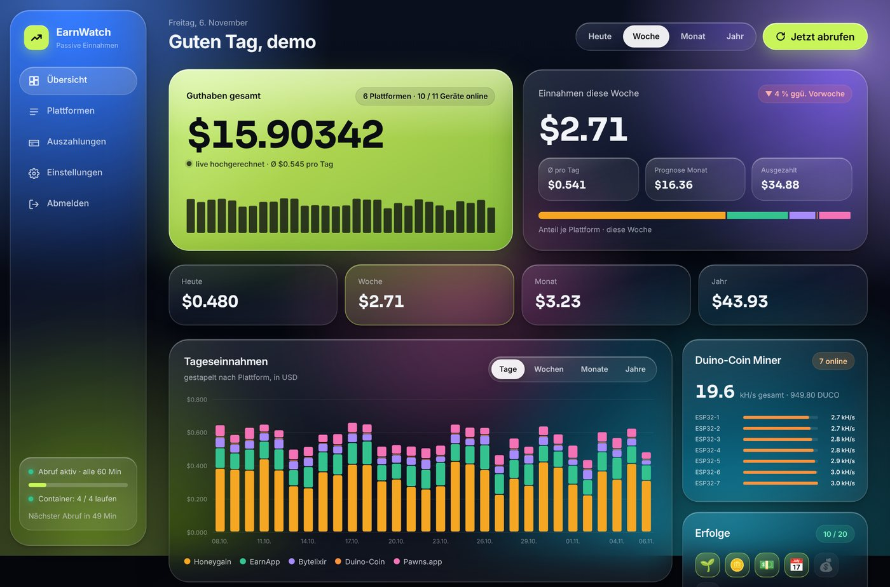

> Alle Bilder zeigen **Beispieldaten**.

---

## Inhalt

1. [Vorschau](#vorschau)
2. [Was EarnWatch kann](#was-earnwatch-kann)
3. [Was du brauchst](#was-du-brauchst)
4. [Installation auf Umbrel](#installation-auf-umbrel)
5. [Installation Schritt für Schritt](#installation-schritt-für-schritt)
6. [Erste Anmeldung](#erste-anmeldung)
7. [Plattformen eintragen](#plattformen-eintragen)
8. [Stil auswählen](#stil-auswählen)
9. [Aufs iPhone holen](#aufs-iphone-holen)
10. [Von unterwegs über Tailscale](#von-unterwegs-über-tailscale)
11. [Benachrichtigungen aufs Handy](#benachrichtigungen-aufs-handy)
12. [Updates & Backups](#updates--backups)
13. [Hilfe bei Problemen](#hilfe-bei-problemen)
14. [Sicherheit](#sicherheit)
15. [Aufbau des Projekts](#aufbau-des-projekts)

---

## Vorschau

### Vier Stile zum Auswählen

**Liquid Glass** – bunte Glasflächen (Standard)


**Dot** – schwarz-weiß mit rotem Akzent und Punktraster

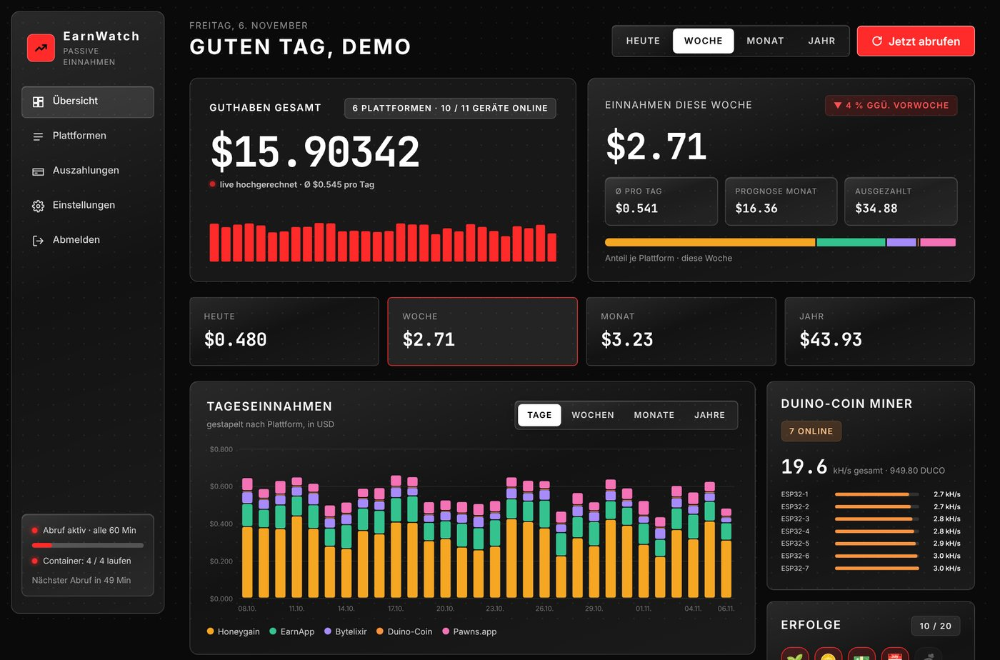

**Frost** – helles Milchglas mit Willkommens-Leiste, schwebender Icon-Leiste, Ring-Diagramm, weicher Linien-Grafik und schwebender Menüleiste

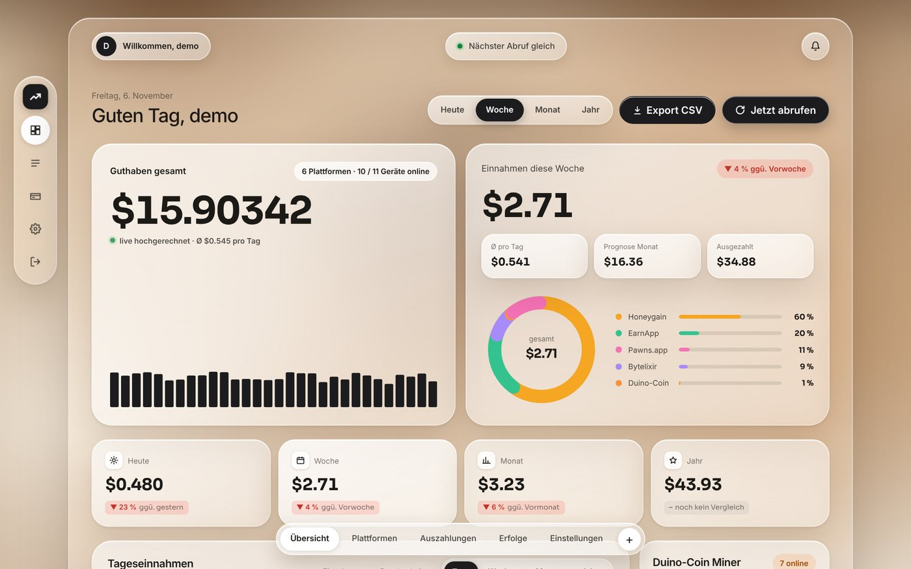

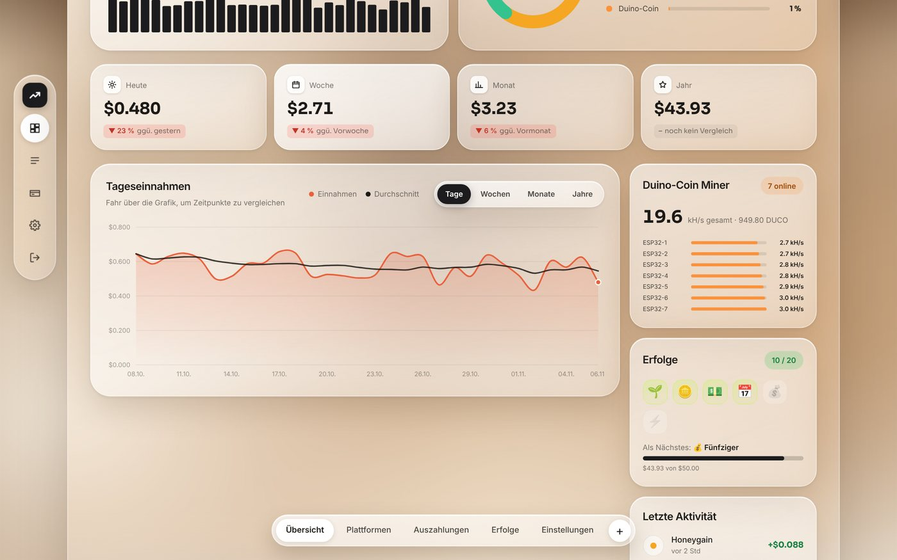

**Peach** – warmes Apricot mit gerippten Formen, eine große Creme-Glasfläche, Mini-Kurven und farbige Prozentwerte

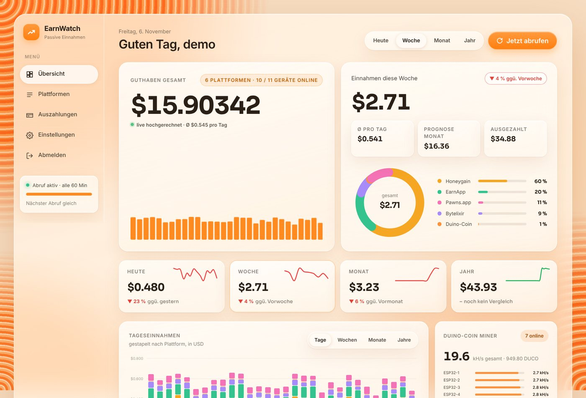

Liquid Glass und Dot gibt es jeweils hell und dunkel (automatisch wie dein Gerät, oder fest eingestellt):

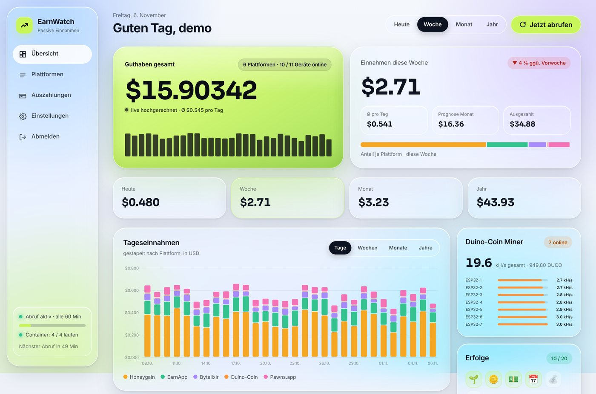

### Auf dem iPhone

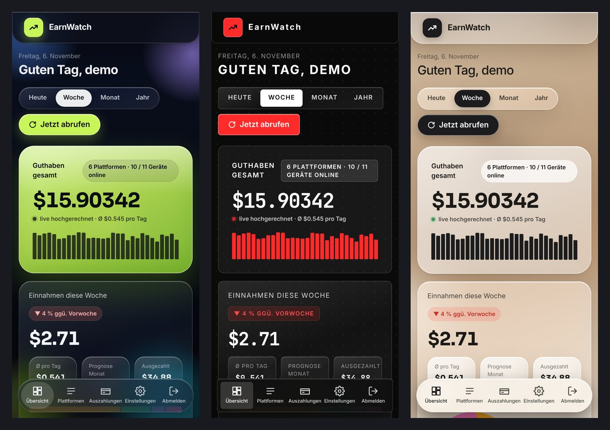

### Eigene Seite für jede Plattform

Ein Tipp auf eine Plattform öffnet ihre eigene Seite mit Diagramm, Guthaben-Verlauf, stärksten Wochentagen,
Geräten und Auszahlungen.

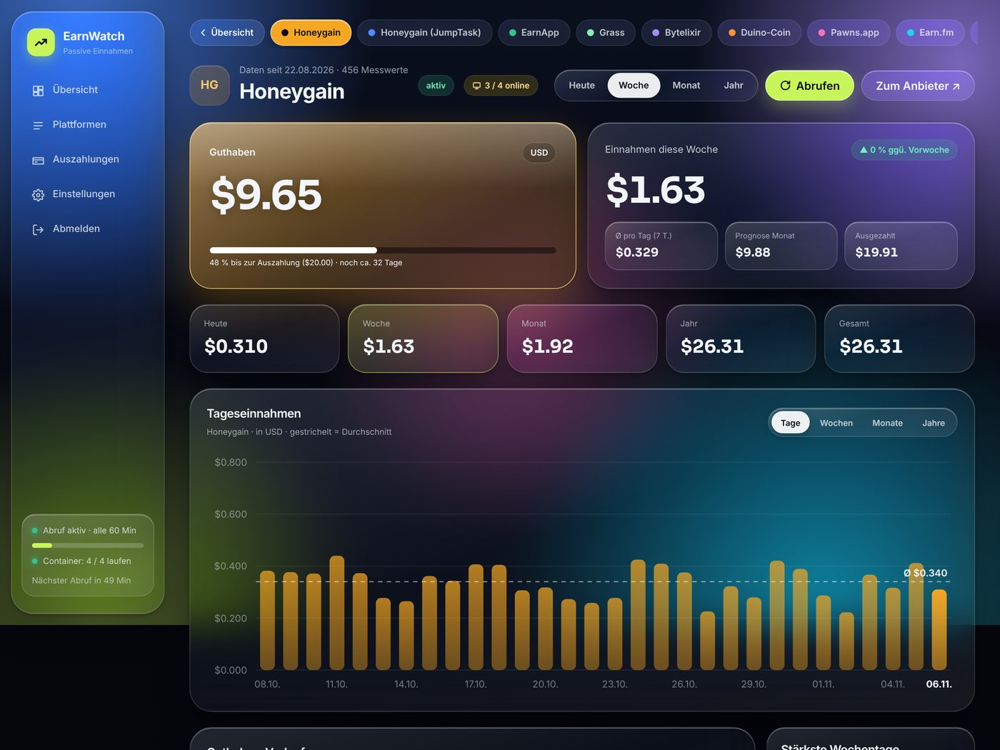

### Erfolge, Einstellungen, Container, Login

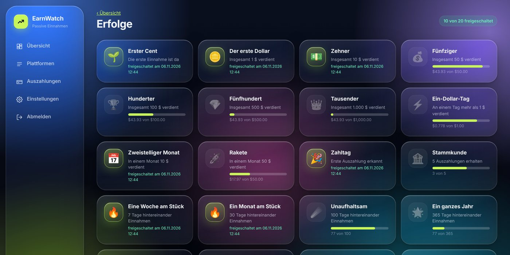

<p>
  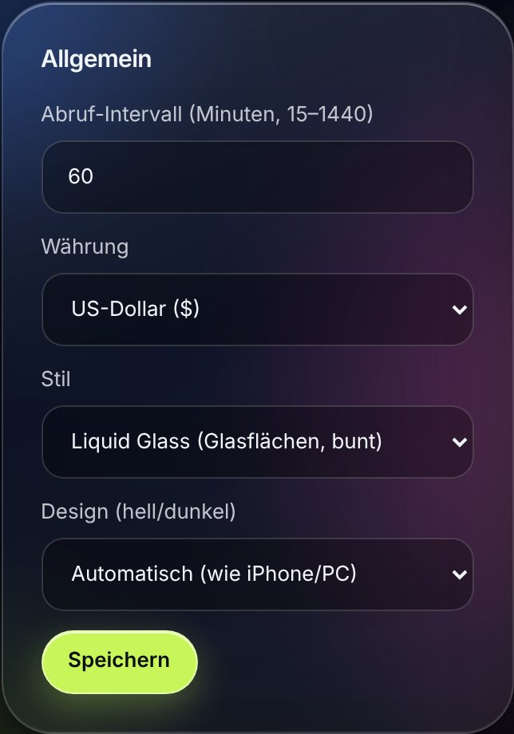
  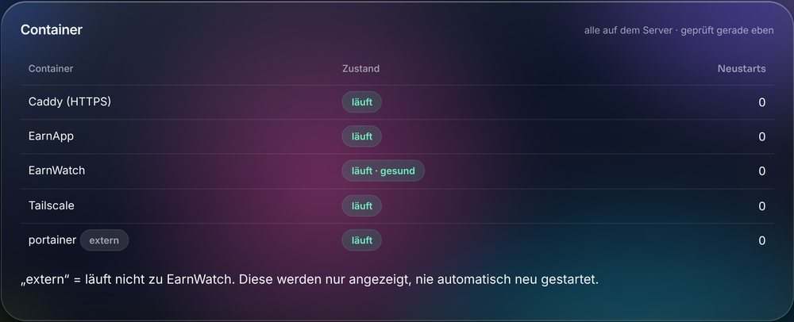
</p>

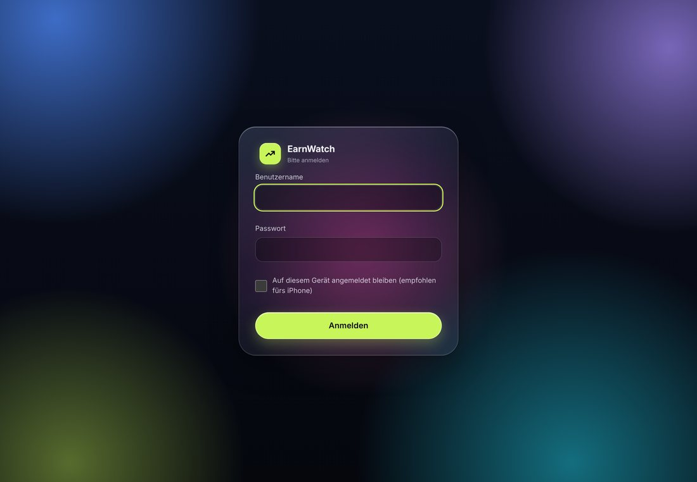

<details>
<summary>Die ganze Übersichtsseite anzeigen</summary>

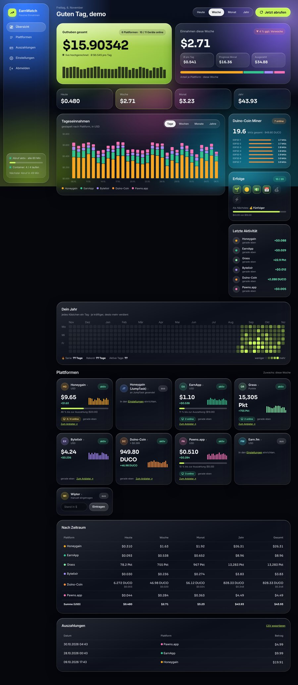

</details>

---

## Was EarnWatch kann

**Plattformen**

| Plattform | Was angezeigt wird | Zugang in EarnWatch |
|---|---|---|
| Honeygain | Guthaben in $, Geräte online, 30 Tage Verlauf | E-Mail + Passwort |
| Honeygain JumpTask | getrennt von Honeygain | nutzt den Honeygain-Zugang |
| EarnApp | Guthaben in $, Geräte online | Cookie `oauth-refresh-token` |
| Grass | Punkte, Geräte online | Token aus dem Browser |
| Bytelixir | Guthaben in $ | Cookie `remember_web_…` |
| Pawns.app | Guthaben in $, Geräte online | E-Mail + Passwort |
| Earn.fm | Guthaben in $ | E-Mail + Passwort |
| Wipter | Guthaben in $ | trägst du selbst ein (keine Schnittstelle) |
| Duino-Coin | DUCO + Wert in $, deine Miner (z. B. ESP32) | nur Benutzername |

**Funktionen**

- Einnahmen **heute / Woche / Monat / Jahr / gesamt**, Diagramm nach Tagen, Wochen, Monaten oder Jahren
- **Live-Zähler** beim Guthaben (hochgerechnet aus deinem 7-Tage-Schnitt)
- **Kalender „Dein Jahr“** mit Serie und Rekord, **Erfolge** zum Freischalten
- Erkennt **Auszahlungen** automatisch (kleine Korrekturen der Anbieter zählen nicht als Auszahlung), zeigt **Prognose** für den Monat
- **Vier Stile** (Liquid Glass, Dot, Frost, Peach), **hell/dunkel**, **Euro** mit Tageskurs der EZB
- **Handy-Benachrichtigungen** (ntfy oder Telegram), **iPhone-Widget**, als **App** auf dem Home-Bildschirm
- **Login mit 2FA** (QR-Code) oder **Face ID / Passkey**
- **Container-Wächter**: zeigt alle Docker-Container, startet abgestürzte EarnWatch-Container neu
- Optional laufen **Honeygain, EarnApp, Pawns und Earn.fm** als Container gleich mit – abgeschottet vom Heimnetz
- **Nächtliche Backups** und **automatische Updates**

---

## Was du brauchst

- Einen Server mit **Linux und Docker**, z. B. eine **Ubuntu- oder Debian-VM auf Proxmox**
  (eine VM ist einfacher als ein LXC-Container)
- Eine **freie IP-Adresse** in deinem Heimnetz für EarnWatch, die dein Router nicht automatisch vergibt
  (z. B. `192.168.178.250`)
- Zugang zum Terminal des Servers als **root** bzw. mit `sudo`

**Docker ist noch nicht installiert?** Auf Ubuntu/Debian geht das mit einem Befehl:

```bash
curl -fsSL https://get.docker.com | sudo sh
```

Prüfen: `sudo docker compose version` sollte eine Versionsnummer anzeigen.

---

## Installation auf Umbrel

EarnWatch gibt es auch als App für **umbrelOS**, über einen eigenen Community App Store.

1. In Umbrel den **App Store** öffnen → oben rechts auf **„⋯“** → **Community App Stores**.
2. Diesen Link einfügen und auf **Add** klicken:
   ```
   https://github.com/kryptostar10-source/earnwatch
   ```
3. Den neuen **„Kryptostar App Store“** öffnen → **EarnWatch** → **Install**.
4. EarnWatch auf dem Umbrel-Startbildschirm öffnen und dein Konto anlegen (kein Einrichtungs-Token nötig –
   Umbrels Login schützt die App schon).

Weiter geht es mit [Plattformen eintragen](#plattformen-eintragen).

**Unterschiede zur Server-Version:** Updates und Backups übernimmt Umbrel. Die Earn-App-Container, die LAN-Sperre
und der Container-Wächter sind nicht dabei (Earn-Apps, falls vorhanden, direkt aus dem Umbrel App Store installieren).
Face ID / Passkeys brauchen HTTPS und gehen deshalb über Umbrels lokale Adresse nicht. Für den Zugriff von unterwegs
die Tailscale-App aus dem Umbrel App Store nehmen. Läuft auf Umbrel Home und Raspberry Pi (Intel/AMD und ARM).

---

## Installation Schritt für Schritt

### 1. Herunterladen

Im Terminal des Servers:

```bash
sudo apt install -y git
sudo git clone https://github.com/kryptostar10-source/earnwatch.git /opt/earnwatch
cd /opt/earnwatch
```

### 2. Installation starten

```bash
sudo bash install.sh
```

Das Skript stellt dir ein paar Fragen. Bei allem, was in eckigen Klammern **groß** geschrieben ist,
reicht **Enter** (`[J/n]` = Enter heißt Ja, `[j/N]` = Enter heißt Nein).

| Frage | Was du machst |
|---|---|
| **Erkanntes Netzwerk … Stimmt das?** | Meist einfach **Enter** |
| **Freie IP für EarnWatch** | Eine freie Adresse eintippen, z. B. `192.168.178.250`. Das Skript prüft, ob sie wirklich frei ist |
| **Fernzugriff über Tailscale einrichten?** | **j**, wenn du EarnWatch auch unterwegs nutzen willst (siehe [Tailscale](#von-unterwegs-über-tailscale)), sonst Enter |
| **Earn-Apps als Container mitlaufen lassen?** | **j**, wenn Honeygain, EarnApp, Pawns oder Earn.fm auf dem Server Geld verdienen sollen. Danach je App fragen, E-Mail/Passwort eingeben |
| **LAN-Sperre einrichten?** | **Enter** (empfohlen): Die Earn-Apps kommen dann nicht an dein Heimnetz |
| **Nächtliches Backup?** | **Enter** |
| **Sonntags automatisch aktualisieren?** | **Enter** |
| **Container-Wächter?** | **Enter** |

> Läuft eine App wie Honeygain schon auf deinem PC, lass sie auf dem Server weg:
> Honeygain und Pawns bezahlen **nur ein Gerät pro Internetanschluss**.

### 3. Fertig

Am Ende zeigt das Skript zum Beispiel:

```
Fertig!
  Öffne von PC/Handy:   https://192.168.178.250   (Zertifikatswarnung einmal bestätigen)
  Einrichtungs-Token:   Xy7…
```

Den **Einrichtungs-Token** brauchst du gleich für die erste Anmeldung. Er steht auch in `/opt/earnwatch/.env`.

> **Wichtig:** Vom Server selbst ist die neue IP nicht erreichbar – das ist bei dieser Netzwerk-Art normal.
> Öffne EarnWatch vom **PC oder Handy** aus.

---

## Erste Anmeldung

1. Am PC im Browser `https://<deine EarnWatch-IP>` öffnen.
2. Die **Zertifikatswarnung** einmal bestätigen („Erweitert“ → „Weiter zu …“). Das Zertifikat ist selbst
   erstellt, das ist im Heimnetz normal. Wie du die Warnung dauerhaft loswirst, steht unter [Sicherheit](#sicherheit).
3. **Einrichtungs-Token** eingeben, Benutzername und Passwort (mindestens 12 Zeichen) festlegen.
4. Empfohlen: Unter **Einstellungen → Zwei-Faktor-Anmeldung → Mit QR-Code einrichten** 2FA einschalten
   (Google/Microsoft Authenticator, Aegis, 2FAS …). Die 8 Wiederherstellungscodes gut aufbewahren.


---

## Plattformen eintragen

Unter **Einstellungen** hat jede Plattform eine eigene Kachel. Trag nur die ein, die du nutzt, und klick auf
**Speichern**. Danach auf der Übersicht **„Jetzt abrufen“** drücken. Ab dann läuft alles automatisch (Standard: stündlich).

<details>
<summary><b>Honeygain, Pawns.app, Earn.fm</b> – E-Mail und Passwort</summary>

Einfach E-Mail und Passwort wie auf der Webseite eintragen.

Meldest du dich dort mit **Google oder Apple** an, hast du kein eigenes Passwort. Setz dir eins:
- Honeygain: auf dashboard.honeygain.com abmelden → „Passwort vergessen“ → neues Passwort setzen
- Pawns: auf dashboard.pawns.app in den Einstellungen ein Passwort festlegen

Honeygain JumpTask braucht nichts Eigenes – es nutzt automatisch den Honeygain-Zugang.
</details>

<details>
<summary><b>EarnApp</b> – Cookie aus dem Browser</summary>

1. Am PC auf **earnapp.com** einloggen.
2. **F12** drücken → Reiter **Anwendung** (Application) → links **Cookies** → `https://earnapp.com`.
3. Den Wert von **`oauth-refresh-token`** kopieren und in EarnWatch einfügen.
</details>

<details>
<summary><b>Grass</b> – Token aus dem Browser</summary>

1. Am PC auf **app.grass.io** einloggen.
2. **F12** → **Anwendung** → **Lokaler Speicher** → `https://app.grass.io`.
3. Den Wert von **`accessToken`** (manchmal `token`) kopieren.

EarnWatch warnt dich 3 Tage bevor dieser Token abläuft.
</details>

<details>
<summary><b>Bytelixir</b> – Cookie aus dem Browser (auch mit 2FA)</summary>

1. Auf **dash.bytelixir.com** abmelden und **mit Haken bei „Remember Me“** neu anmelden
   (inklusive 2FA-Code, falls aktiv).
2. **F12** → **Anwendung** → **Cookies** → `https://dash.bytelixir.com`.
3. Kopieren:
   - **`remember_web_…`** (langer Name, Pflicht – hält etwa ein Jahr)
   - `bytelixir_session`
   - `XSRF-TOKEN` (optional)

Gibt es kein `remember_web_…`, hast du ohne den Haken angemeldet.
</details>

<details>
<summary><b>Wipter</b> und <b>Duino-Coin</b></summary>

- **Wipter** hat keine Schnittstelle. Den Kontostand trägst du auf der Übersicht in der Wipter-Kachel selbst ein.
- **Duino-Coin** braucht nur deinen **Benutzernamen** – die Kontostände sind öffentlich. EarnWatch zeigt auch
  deine Miner (z. B. ESP32) mit Hashrate.
</details>

> Tageseinnahmen entstehen aus dem Unterschied zwischen zwei Abrufen. Das Diagramm füllt sich deshalb
> in den ersten Stunden. Honeygain bringt seine letzten 30 Tage gleich mit.

---

## Stil auswählen

**Einstellungen → Allgemein**


- **Stil:** Liquid Glass, Dot, Frost oder Peach
- **Design (hell/dunkel):** automatisch wie dein iPhone/PC, immer hell oder immer dunkel
  (Frost und Peach sind immer hell)
- **Währung:** Dollar oder Euro (Kurs kommt täglich automatisch von der Europäischen Zentralbank)

Auf **Speichern** drücken – die Seite stellt sofort um.

---

## Aufs iPhone holen

EarnWatch lässt sich wie eine App auf den Home-Bildschirm legen:

1. Seite in **Safari** öffnen.
2. Teilen-Knopf → **„Zum Home-Bildschirm“**.
3. Beim Login **„Auf diesem Gerät angemeldet bleiben“** anhaken. Dann bleibst du angemeldet, solange du
   EarnWatch mindestens alle 30 Tage öffnest.

**Face ID statt Passwort:** Einstellungen → **Face ID / Passkey** → Passwort eingeben → „Passkey hinzufügen“.
Danach auf der Login-Seite „Mit Face ID anmelden“. Das geht nur über die **Tailscale-Adresse** (…ts.net),
nicht über die IP.

**Widget auf dem Home-Bildschirm:** Einstellungen → **iPhone-Widget** → „Widget einrichten“ (am besten über die
Tailscale-Adresse). Das angezeigte Skript in die kostenlose App **Scriptable** kopieren. Der Schlüssel darf nur
Summen lesen und lässt sich jederzeit löschen.

---

## Von unterwegs über Tailscale

Mit Tailscale erreichst du **nur EarnWatch** von unterwegs – mit echtem Zertifikat, ohne Portfreigabe im Router.
Dein restliches Heimnetz bleibt unsichtbar, aus dem offenen Internet ist die Seite nicht erreichbar.

1. Kostenloses Konto auf **login.tailscale.com** anlegen.
2. Auf **login.tailscale.com/admin/dns** **MagicDNS** und **HTTPS Certificates** einschalten.
3. Auf **login.tailscale.com/admin/settings/keys** → **„Generate auth key“** → Schlüssel kopieren.
4. Auf dem Server `sudo bash /opt/earnwatch/install.sh` → bei „Tailscale“ **j** → Schlüssel einfügen
   (man sieht beim Einfügen keine Zeichen, das ist normal) → Rest mit Enter.
5. Tailscale-App aufs iPhone, mit demselben Konto anmelden.

Am Ende zeigt das Skript deine Adresse, z. B. `https://earnwatch.tail1234.ts.net`.

> **Tipp:** In der Tailscale-Verwaltung beim Gerät „earnwatch“ unter „…“ **Disable key expiry** wählen,
> sonst musst du es nach 180 Tagen neu anmelden.

---

## Benachrichtigungen aufs Handy

**Einstellungen → Benachrichtigungen aufs Handy**

1. App **ntfy** aus dem App Store installieren (kostenlos, ohne Anmeldung – nicht verwechseln mit ähnlich
   klingenden Apps).
2. In EarnWatch das vorgeschlagene **Thema** speichern.
3. In der ntfy-App auf **„+“** → genau dieses Thema abonnieren.
4. In EarnWatch **„Test senden“** drücken.

Alternativ oder zusätzlich geht **Telegram** (Bot-Token + Chat-ID).

Gemeldet wird (einzeln abschaltbar):
💰 Auszahlung möglich · ⚠️ Abruf fehlgeschlagen · 📴 Gerät/Miner offline · 🔐 neue Anmeldung ·
🔑 Sicherheits-Änderungen · 📊 Tageszusammenfassung · 🏅 neuer Erfolg · 🐳 Container abgestürzt · ⏳ Login läuft bald ab

> Das ntfy-Thema ist wie ein Passwort: Wer es kennt, kann mitlesen.

---

## Updates & Backups

**Aktualisieren** (holt die neueste Version und Sicherheits-Updates):

```bash
cd /opt/earnwatch && sudo git pull && sudo docker compose up -d --build
```

Hast du bei der Installation „Sonntags automatisch aktualisieren“ gewählt, passiert das von selbst.
Nach größeren Updates einmal `sudo bash install.sh` ausführen (alles mit Enter) – dann werden auch neue
Hintergrund-Dienste eingerichtet. Deine Daten und Einstellungen bleiben immer erhalten.

**Backups** laufen jede Nacht um 3:30 nach `/var/backups/earnwatch` (die letzten 7 bleiben):

```bash
sudo bash /opt/earnwatch/backup.sh                 # Backup jetzt
sudo bash /opt/earnwatch/restore.sh                # vorhandene Backups anzeigen
sudo bash /opt/earnwatch/restore.sh <datei>        # wiederherstellen
systemctl list-timers 'earnwatch-*'                # wann läuft was
```

Kopier ab und zu ein Backup auf einen anderen Rechner oder USB-Stick. Es enthält den Schlüssel zu deinen
gespeicherten Zugangsdaten – also sicher aufbewahren.

---

## Hilfe bei Problemen

<details>
<summary><b>Die Seite lädt nicht</b></summary>

- Vom **PC oder Handy** öffnen, nicht vom Server selbst.
- In Proxmox bei der VM unter *Hardware → Netzwerkkarte* die **Firewall** ausschalten
  (EarnWatch nutzt eine zusätzliche MAC-Adresse).
- Läuft alles? `cd /opt/earnwatch && sudo docker compose ps`
</details>

<details>
<summary><b>Ein Container steht auf „Restarting“</b> (Honeygain, Pawns …)</summary>

Log ansehen:

```bash
sudo docker logs --tail 20 honeygain
```

- `not_valid_login_credentials` → E-Mail oder Passwort falsch. Neu eintragen (prüft die Daten direkt beim Anbieter):
  ```bash
  sudo bash /opt/earnwatch/zugangsdaten.sh honeygain
  ```
- `too many tries to log in` (Pawns) → Pawns sperrt kurz. `sudo bash zugangsdaten.sh pawns` und bei der Sperr-Frage
  **j** – dann startet Pawns erst nach 60 Minuten neu.
- `please use SDK or gui app` (Pawns) → Pawns lässt die Kommandozeile für dein Konto nicht zu. Lass Pawns
  dann mit der normalen App auf dem PC laufen und nimm es auf dem Server heraus (siehe nächster Punkt).
</details>

<details>
<summary><b>Honeygain zeigt „network unused“ / eine App verdient auf dem Server nichts</b></summary>

Honeygain und Pawns bezahlen **nur ein Gerät pro Internetanschluss**. Läuft die App schon auf deinem PC,
nimm sie auf dem Server heraus:

```bash
cd /opt/earnwatch && sudo docker compose stop honeygain && sudo docker compose rm -f honeygain
sudo nano .env      # in COMPOSE_PROFILES das Wort "honeygain" samt Komma löschen
```

Deine Einnahmen siehst du trotzdem weiter in EarnWatch – die werden direkt aus deinem Konto gelesen.
</details>

<details>
<summary><b>Tailscale steht auf „Restarting“</b></summary>

Meist ist das Gerät abgemeldet (gelöscht oder nach 180 Tagen abgelaufen). Neuen Auth-Key erzeugen
(siehe [Tailscale](#von-unterwegs-über-tailscale)), dann `sudo bash /opt/earnwatch/install.sh` → bei Tailscale **j** →
Schlüssel einfügen.
</details>

<details>
<summary><b>Bytelixir: „Kontostand nicht gefunden“ oder „Sitzung abgelaufen“</b></summary>

- „Sitzung abgelaufen“ → Cookies neu kopieren (siehe [Plattformen eintragen](#plattformen-eintragen)).
- „Kontostand nicht gefunden“ → Bytelixir hat seine Seite geändert. Bitte ein Issue auf GitHub öffnen.
</details>

<details>
<summary><b>„sudo systemctl …“ meldet „Failed to connect to bus“</b></summary>

Du bist wahrscheinlich in Ubuntu unter Windows (WSL) oder in einem Container. Dann statt `systemctl`:

```bash
sudo service docker start
```
</details>

<details>
<summary><b>2FA-Handy und Wiederherstellungscodes verloren</b></summary>

```bash
cd /opt/earnwatch && sudo docker compose stop earnwatch
sudo docker run --rm -v earnwatch_earnwatch_data:/d alpine sh -c "apk add -q sqlite && sqlite3 /d/earnwatch.db 'UPDATE users SET totp_secret=NULL, recovery=NULL, session_ver=session_ver+1'"
sudo docker compose start earnwatch
```
</details>

<details>
<summary><b>Passwort vergessen</b></summary>

Konto zurücksetzen und mit dem Einrichtungs-Token (steht in `/opt/earnwatch/.env`) neu anlegen.
Deine gespeicherten Daten bleiben erhalten.

```bash
cd /opt/earnwatch && sudo docker compose stop earnwatch
sudo docker run --rm -v earnwatch_earnwatch_data:/d alpine sh -c "apk add -q sqlite && sqlite3 /d/earnwatch.db 'DELETE FROM users'"
sudo docker compose start earnwatch
```
</details>

<details>
<summary><b>Läuft nach einem Neustart alles von selbst wieder?</b></summary>

Ja. Alle Container starten von allein, auch die LAN-Sperre, Backups und Updates.
Ausnahme: Container, die du vorher **von Hand gestoppt** hast, bleiben aus. Wieder starten mit
`cd /opt/earnwatch && sudo docker compose up -d`. Damit die Proxmox-VM selbst hochfährt, bei ihr
unter *Optionen* **„Start at boot“** einschalten.
</details>

---

## Sicherheit

EarnWatch ist von Grund auf auf Sicherheit gebaut:

| | |
|---|---|
| **Erreichbarkeit** | Eigene IP im Heimnetz, nur **HTTPS**, nur aus privaten Netzen. Von unterwegs nur über Tailscale – nie offen im Internet |
| **Login** | Passwort-Hash mit scrypt, Sperre nach 5 Fehlversuchen (pro IP **und** pro Benutzer), optional **2FA** oder **Passkey/Face ID** |
| **Zugangsdaten** | Verschlüsselt gespeichert, werden **nie** wieder angezeigt oder ins Log geschrieben |
| **Web-Schutz** | Jedes Formular braucht einen geheimen Schlüssel (CSRF) und wird auf Herkunft geprüft. Strenge CSP: **kein JavaScript** auf den Seiten (einzige Ausnahme: die eigene Passkey-Datei auf Login- und Einstellungsseite) |
| **Container** | EarnWatch läuft ohne Root-Rechte, mit schreibgeschütztem Dateisystem und **ohne Zugriff auf Docker** |
| **Earn-Apps** | Laufen in einem eigenen Netz und dürfen per **LAN-Sperre** nicht in dein Heimnetz |
| **Ersteinrichtung** | Das erste Konto lässt sich nur mit dem geheimen Einrichtungs-Token anlegen |

**Zertifikatswarnung dauerhaft loswerden:** Das Stammzertifikat von EarnWatch einmal auf deinen Geräten installieren:

```bash
cd /opt/earnwatch && sudo docker compose exec caddy cat /data/caddy/pki/authorities/local/root.crt > earnwatch-root.crt
```

Die Datei auf PC/Mac/Handy kopieren und als vertrauenswürdige Stammzertifizierungsstelle importieren
(Windows: Doppelklick → „Vertrauenswürdige Stammzertifizierungsstellen“, Mac: Schlüsselbund → „Immer vertrauen“).

> Die Tokens von Grass, EarnApp und Bytelixir sind Login-Schlüssel – wer sie hat, kommt in dein Konto.
> Gib sie nie weiter.

---

## Aufbau des Projekts

```
earnwatch/
├── install.sh            # Einrichtung (Fragen beantworten, fertig)
├── update.sh             # Update (mit Backup vorher)
├── backup.sh / restore.sh
├── zugangsdaten.sh       # Logins der Earn-App-Container neu eintragen und prüfen
├── healthcheck.sh        # Container-Wächter (läuft alle 5 Min.)
├── lan-guard.sh          # LAN-Sperre für die Earn-Apps
├── docker-compose.yml    # EarnWatch + Caddy (HTTPS) + Tailscale + Earn-Apps
├── Caddyfile
├── .env.example
├── umbrel-app-store.yml  # Umbrel Community App Store
├── kryptostar-earnwatch/ # die Umbrel-App (Beschreibung + Compose)
├── docs/screenshots/     # Bilder dieser Anleitung
└── app/earnwatch/        # Python-App (Starlette)
    ├── main.py           # Seiten, Login, Sicherheit, Zeitplan
    ├── collectors.py     # Abruf der Plattformen
    ├── stats.py, charts.py
    ├── webauthn.py       # Face ID / Passkey
    ├── notify.py, events.py
    └── templates/ static/
```

Die Schriften **Sora** und **JetBrains Mono** stehen unter der SIL Open Font License
(Lizenzen in `app/earnwatch/static/fonts/`) und werden lokal ausgeliefert – es wird nichts von außen nachgeladen.
