# EarnWatch – all your passive income in one place

🇬🇧 **English** · 🇩🇪 [Deutsch](README.de.md)

EarnWatch is a secure, self-hosted dashboard for your home server (for example Proxmox with Docker).
It regularly checks your balances on Honeygain, EarnApp, Grass, Bytelixir, Pawns.app, Earn.fm,
Wipter and Duino-Coin and shows what you earn **today, this week, this month and this year** –
on your PC, on your iPhone and, if you like, on the go.

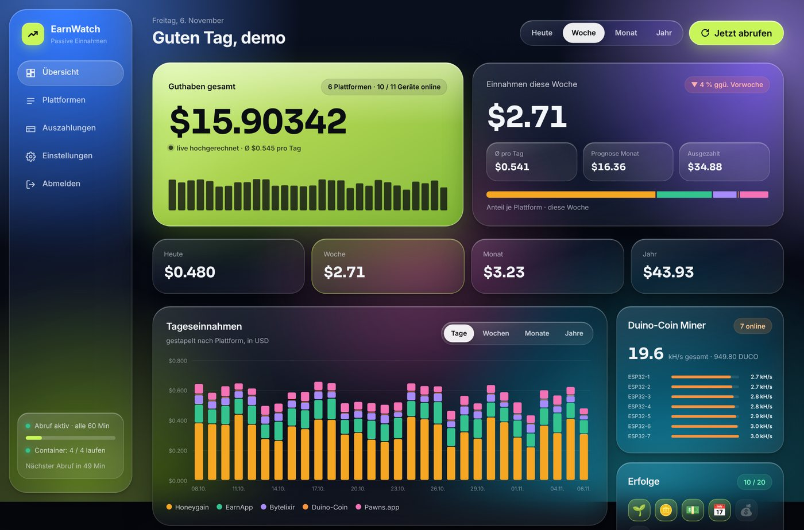

> All screenshots show **sample data**. The user interface is currently in **German**.

---

## Contents

1. [Preview](#preview)
2. [Features](#features)
3. [Requirements](#requirements)
4. [Installation step by step](#installation-step-by-step)
5. [First login](#first-login)
6. [Adding your platforms](#adding-your-platforms)
7. [Choosing a style](#choosing-a-style)
8. [Using it on your iPhone](#using-it-on-your-iphone)
9. [Remote access with Tailscale](#remote-access-with-tailscale)
10. [Phone notifications](#phone-notifications)
11. [Updates & backups](#updates--backups)
12. [Troubleshooting](#troubleshooting)
13. [Security](#security)
14. [Project structure](#project-structure)

---

## Preview

### Three styles to choose from

**Liquid Glass** – colourful glass panels (default)


**Dot** – black and white with a red accent and a dot grid

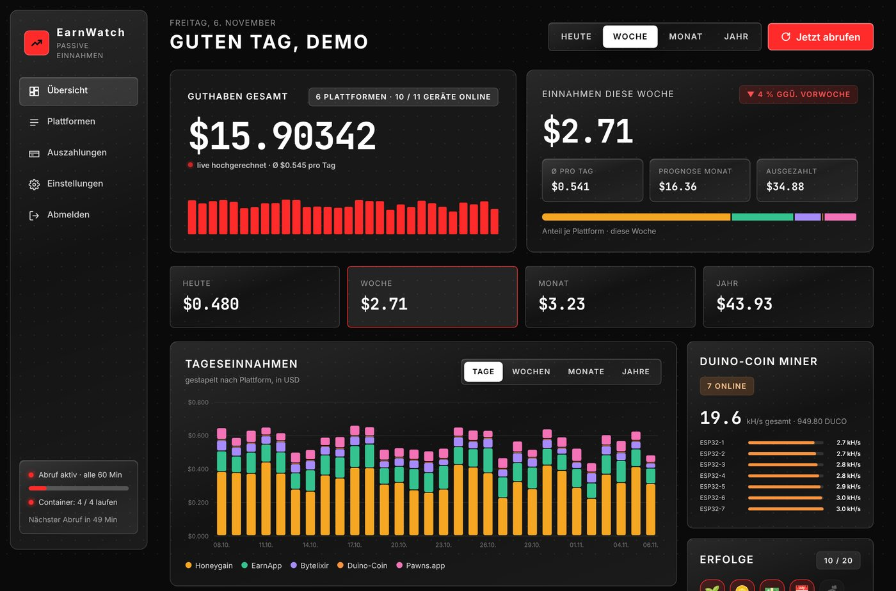

**Frost** – light frosted glass, floating icon bar and a donut chart

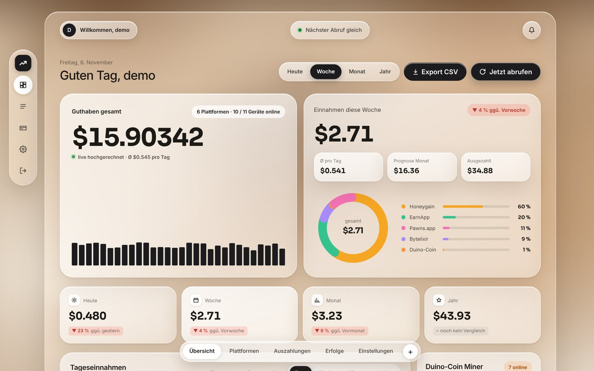

Liquid Glass and Dot come in light and dark (automatic like your device, or fixed):

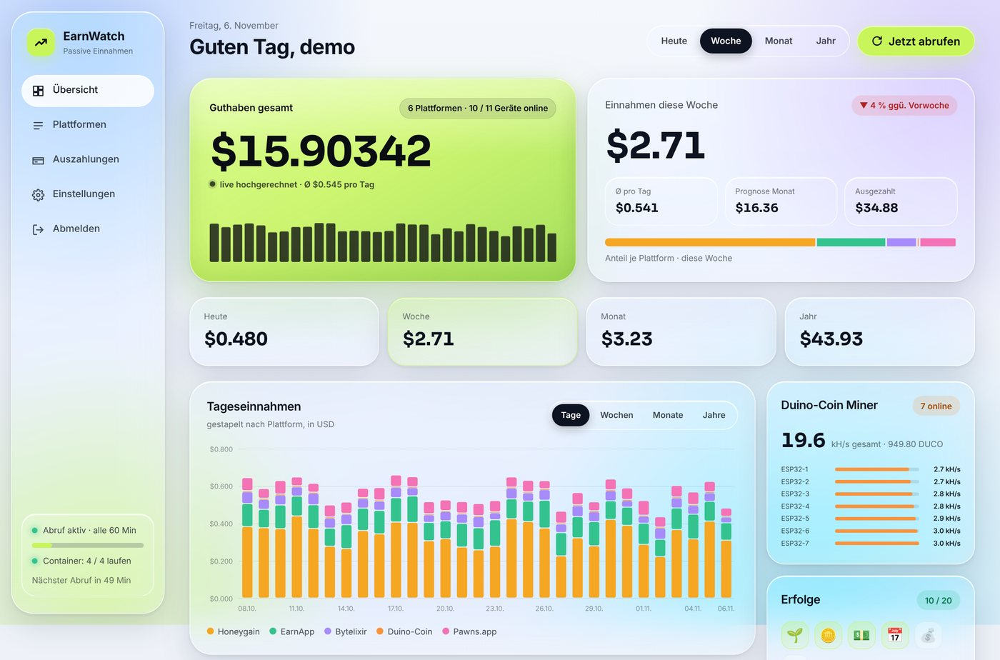

### On the iPhone

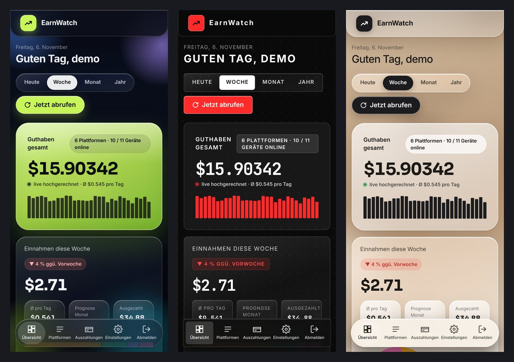

### A page for every platform

Tap a platform to open its own page with a chart, balance history, best weekdays, devices and payouts.

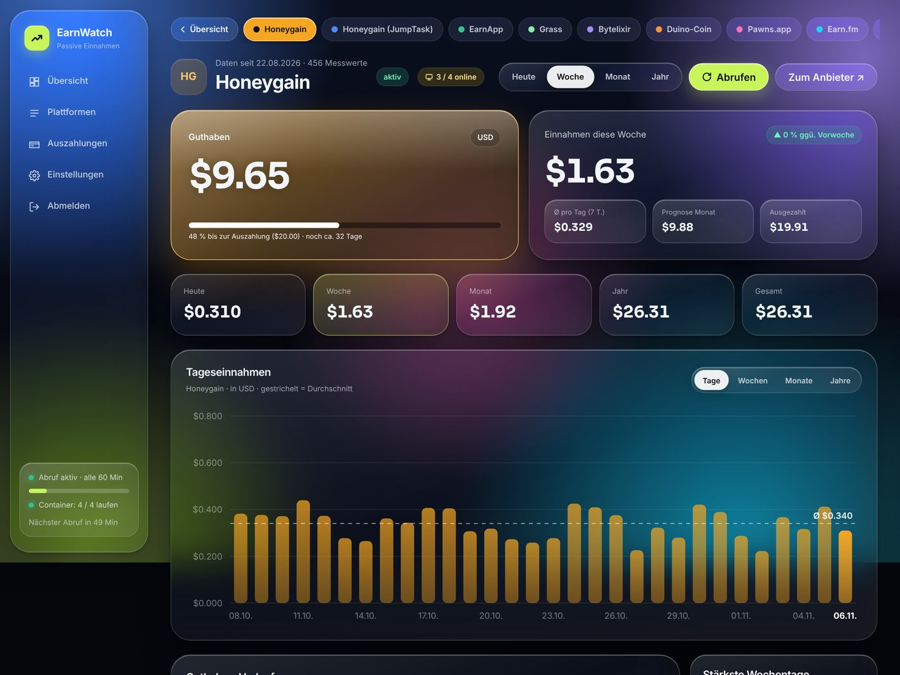

### Achievements, settings, containers, login

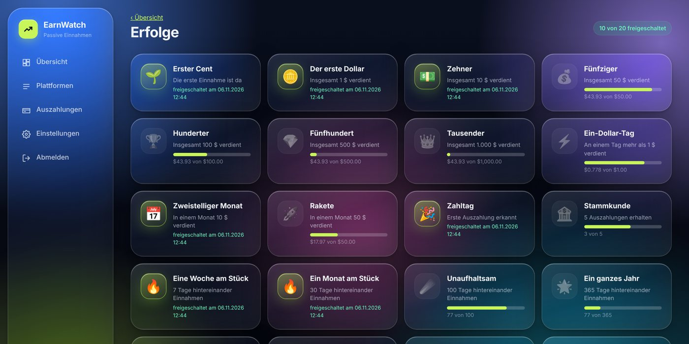

<p>
  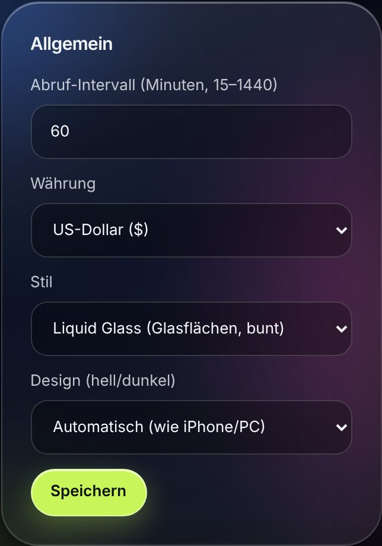
  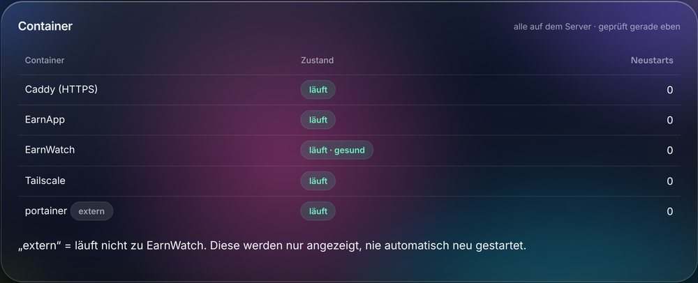
</p>

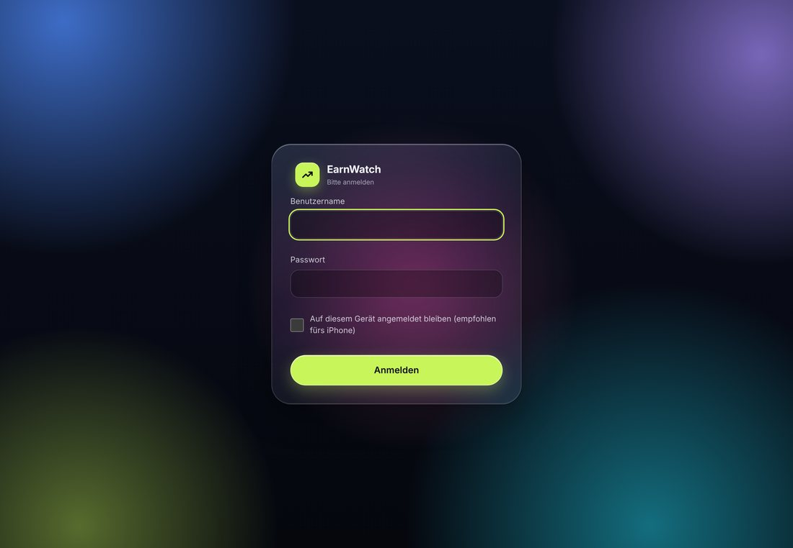

<details>
<summary>Show the full dashboard page</summary>

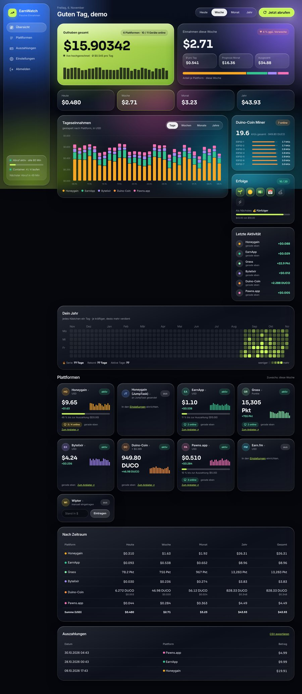

</details>

---

## Features

**Platforms**

| Platform | What you see | What EarnWatch needs |
|---|---|---|
| Honeygain | Balance in $, devices online, last 30 days | Email + password |
| Honeygain JumpTask | Shown separately from Honeygain | Uses your Honeygain login |
| EarnApp | Balance in $, devices online | Browser cookie `oauth-refresh-token` |
| Grass | Points, devices online | Token from your browser |
| Bytelixir | Balance in $ | Browser cookie `remember_web_…` |
| Pawns.app | Balance in $, devices online | Email + password |
| Earn.fm | Balance in $ | Email + password |
| Wipter | Balance in $ | You enter it yourself (no API) |
| Duino-Coin | DUCO + value in $, your miners (e.g. ESP32) | Username only |

**What it does**

- Earnings for **today / week / month / year / total**, chart by days, weeks, months or years
- **Live counter** on your balance (projected from your 7-day average)
- **"Your year" calendar** with streak and record, **achievements** to unlock
- Detects **payouts** automatically and shows a **monthly forecast**
- **Three styles** (Liquid Glass, Dot, Frost), **light/dark**, **euro** with the daily ECB exchange rate
- **Phone notifications** (ntfy or Telegram), **iPhone widget**, installable as an **app** on your home screen
- **Login with 2FA** (QR code) or **Face ID / passkey**
- **Container watchdog**: lists all Docker containers and restarts crashed EarnWatch containers
- Optionally runs **Honeygain, EarnApp, Pawns and Earn.fm** as containers – isolated from your home network
- **Nightly backups** and **automatic updates**

---

## Requirements

- A server running **Linux and Docker**, e.g. an **Ubuntu or Debian VM on Proxmox**
  (a VM is easier than an LXC container)
- A **free IP address** in your home network for EarnWatch that your router does not hand out automatically
  (e.g. `192.168.178.250`)
- Terminal access to the server as **root** or with `sudo`

**Docker not installed yet?** On Ubuntu/Debian it takes one command:

```bash
curl -fsSL https://get.docker.com | sudo sh
```

Check: `sudo docker compose version` should print a version number.

---

## Installation step by step

### 1. Download

In the server's terminal:

```bash
sudo apt install -y git
sudo git clone https://github.com/kryptostar10-source/earnwatch.git /opt/earnwatch
cd /opt/earnwatch
```

### 2. Run the installer

```bash
sudo bash install.sh
```

The installer asks a few questions **in German**. Here is what they mean. Wherever the brackets show a
**capital** letter, just press **Enter** (`[J/n]` = Enter means yes, `[j/N]` = Enter means no; `j` = yes).

| Question (German) | Meaning | What to do |
|---|---|---|
| **Erkanntes Netzwerk … Stimmt das?** | Detected network – correct? | Usually just **Enter** |
| **Freie IP für EarnWatch** | Free IP for EarnWatch | Type a free address, e.g. `192.168.178.250`. The script checks that it really is free |
| **Fernzugriff über Tailscale einrichten?** | Set up remote access via Tailscale? | **j** if you want to use EarnWatch on the go (see [Tailscale](#remote-access-with-tailscale)), otherwise Enter |
| **Earn-Apps als Container mitlaufen lassen?** | Run earning apps as containers? | **j** if Honeygain, EarnApp, Pawns or Earn.fm should earn on the server. It then asks per app for email/password |
| **LAN-Sperre einrichten?** | Set up the LAN lock? | **Enter** (recommended): the earning apps can't reach your home network |
| **Jede Nacht ein Backup machen?** | Nightly backup? | **Enter** |
| **Jeden Sonntag automatisch aktualisieren?** | Auto-update every Sunday? | **Enter** |
| **Container-Wächter?** | Container watchdog? | **Enter** |

> If an app like Honeygain already runs on your PC, leave it off the server:
> Honeygain and Pawns pay for **only one device per internet connection**.

### 3. Done

At the end the script shows something like:

```
Fertig!
  Öffne von PC/Handy:   https://192.168.178.250   (Zertifikatswarnung einmal bestätigen)
  Einrichtungs-Token:   Xy7…
```

You need the **setup token** (*Einrichtungs-Token*) for your first login. It is also stored in `/opt/earnwatch/.env`.

> **Important:** The new IP cannot be reached from the server itself – that is normal for this network type.
> Open EarnWatch from your **PC or phone**.

---

## First login

1. On your PC, open `https://<your EarnWatch IP>` in the browser.
2. Accept the **certificate warning** once ("Advanced" → "Proceed to …"). The certificate is self-signed,
   which is normal on a home network. See [Security](#security) for how to get rid of the warning for good.
3. Enter the **setup token** and choose a username and password (at least 12 characters).
4. Recommended: turn on 2FA under **Einstellungen → Zwei-Faktor-Anmeldung → Mit QR-Code einrichten**
   (Settings → Two-factor login → Set up with QR code) using Google/Microsoft Authenticator, Aegis, 2FAS, …
   Keep the 8 recovery codes somewhere safe.


---

## Adding your platforms

Under **Einstellungen** (Settings) every platform has its own card. Fill in only the ones you use and click
**Speichern** (Save). Then press **"Jetzt abrufen"** (Fetch now) on the dashboard. From then on everything runs
automatically (every hour by default).

<details>
<summary><b>Honeygain, Pawns.app, Earn.fm</b> – email and password</summary>

Enter the same email and password you use on their website.

If you sign in there with **Google or Apple**, you don't have your own password. Set one first:
- Honeygain: log out on dashboard.honeygain.com → "Forgot password" → set a new password
- Pawns: set a password in the settings on dashboard.pawns.app

Honeygain JumpTask needs nothing extra – it uses your Honeygain login automatically.
</details>

<details>
<summary><b>EarnApp</b> – cookie from your browser</summary>

1. Log in to **earnapp.com** on your PC.
2. Press **F12** → **Application** tab → **Cookies** on the left → `https://earnapp.com`.
3. Copy the value of **`oauth-refresh-token`** and paste it into EarnWatch.
</details>

<details>
<summary><b>Grass</b> – token from your browser</summary>

1. Log in to **app.grass.io** on your PC.
2. **F12** → **Application** → **Local Storage** → `https://app.grass.io`.
3. Copy the value of **`accessToken`** (sometimes `token`).

EarnWatch warns you 3 days before this token expires.
</details>

<details>
<summary><b>Bytelixir</b> – cookie from your browser (works with 2FA too)</summary>

1. Log out on **dash.bytelixir.com** and log in again **with "Remember Me" ticked**
   (including your 2FA code if enabled).
2. **F12** → **Application** → **Cookies** → `https://dash.bytelixir.com`.
3. Copy:
   - **`remember_web_…`** (long name, required – lasts about a year)
   - `bytelixir_session`
   - `XSRF-TOKEN` (optional)

If there is no `remember_web_…` cookie, you logged in without the "Remember Me" tick.
</details>

<details>
<summary><b>Wipter</b> and <b>Duino-Coin</b></summary>

- **Wipter** has no API. You enter your balance yourself on the Wipter card on the dashboard.
- **Duino-Coin** only needs your **username** – balances are public. EarnWatch also shows your miners
  (e.g. ESP32) with their hash rate.
</details>

> Daily earnings are calculated from the difference between two fetches, so the chart fills up over the first
> few hours. Honeygain brings its last 30 days right away.

---

## Choosing a style

**Einstellungen → Allgemein** (Settings → General)


- **Stil** (style): Liquid Glass, Dot or Frost
- **Design (hell/dunkel)** (light/dark): automatic like your iPhone/PC, always light or always dark
  (Frost is always light)
- **Währung** (currency): US dollar or euro (the rate comes automatically every day from the European Central Bank)

Press **Speichern** (Save) – the page switches right away.

---

## Using it on your iPhone

You can put EarnWatch on your home screen like an app:

1. Open the page in **Safari**.
2. Share button → **"Add to Home Screen"**.
3. When logging in, tick **"Auf diesem Gerät angemeldet bleiben"** (stay signed in on this device). You then stay
   signed in as long as you open EarnWatch at least every 30 days.

**Face ID instead of a password:** Settings → **Face ID / Passkey** → enter your password → "Passkey hinzufügen"
(add passkey). After that use "Mit Face ID anmelden" (sign in with Face ID) on the login page. This only works via your
**Tailscale address** (…ts.net), not via the IP.

**Home screen widget:** Settings → **iPhone-Widget** → "Widget einrichten" (set up widget), ideally via the Tailscale
address. Copy the script shown into the free app **Scriptable**. The key can only read totals and can be deleted at any time.

---

## Remote access with Tailscale

With Tailscale you can reach **only EarnWatch** on the go – with a real certificate and no port forwarding on your router.
The rest of your home network stays invisible, and the page is not reachable from the open internet.

1. Create a free account at **login.tailscale.com**.
2. At **login.tailscale.com/admin/dns** turn on **MagicDNS** and **HTTPS Certificates**.
3. At **login.tailscale.com/admin/settings/keys** → **"Generate auth key"** → copy the key.
4. On the server run `sudo bash /opt/earnwatch/install.sh` → answer **j** at "Tailscale" → paste the key
   (you won't see any characters while pasting, that's normal) → press Enter for the rest.
5. Install the Tailscale app on your iPhone and sign in with the same account.

At the end the script shows your address, e.g. `https://earnwatch.tail1234.ts.net`.

> **Tip:** In the Tailscale admin, open "…" on the device "earnwatch" and choose **Disable key expiry**,
> otherwise you have to sign it in again after 180 days.

---

## Phone notifications

**Einstellungen → Benachrichtigungen aufs Handy** (Settings → Phone notifications)

1. Install the app **ntfy** (free, no account – don't confuse it with similar-sounding apps).
2. Save the suggested **topic** in EarnWatch.
3. In the ntfy app tap **"+"** → subscribe to exactly that topic.
4. Press **"Test senden"** (send test) in EarnWatch.

**Telegram** works as an alternative or in addition (bot token + chat ID).

You can be notified about (each can be switched off):
💰 payout possible · ⚠️ fetch failed · 📴 device/miner offline · 🔐 new login ·
🔑 security changes · 📊 daily summary · 🏅 new achievement · 🐳 container crashed · ⏳ login about to expire

> The ntfy topic is like a password: anyone who knows it can read along.

---

## Updates & backups

**Update** (gets the latest version and security updates):

```bash
cd /opt/earnwatch && sudo git pull && sudo docker compose up -d --build
```

If you chose "auto-update every Sunday" during installation, this happens by itself.
After bigger updates, run `sudo bash install.sh` once (Enter for everything) so new background services get set up too.
Your data and settings are always kept.

**Backups** run every night at 3:30 into `/var/backups/earnwatch` (the last 7 are kept):

```bash
sudo bash /opt/earnwatch/backup.sh                 # back up now
sudo bash /opt/earnwatch/restore.sh                # list available backups
sudo bash /opt/earnwatch/restore.sh <file>         # restore
systemctl list-timers 'earnwatch-*'                # what runs when
```

Copy a backup to another computer or a USB stick now and then. It contains the key to your stored logins,
so keep it safe.

---

## Troubleshooting

<details>
<summary><b>The page doesn't load</b></summary>

- Open it from your **PC or phone**, not from the server itself.
- In Proxmox, turn off the **firewall** on the VM under *Hardware → Network Device*
  (EarnWatch uses an additional MAC address).
- Is everything running? `cd /opt/earnwatch && sudo docker compose ps`
</details>

<details>
<summary><b>A container keeps "Restarting"</b> (Honeygain, Pawns, …)</summary>

Look at the log:

```bash
sudo docker logs --tail 20 honeygain
```

- `not_valid_login_credentials` → wrong email or password. Enter them again (the script checks them directly with the provider):
  ```bash
  sudo bash /opt/earnwatch/zugangsdaten.sh honeygain
  ```
- `too many tries to log in` (Pawns) → Pawns blocks you for a while. Run `sudo bash zugangsdaten.sh pawns` and answer
  **j** to the lock question – Pawns then only restarts after 60 minutes.
- `please use SDK or gui app` (Pawns) → Pawns doesn't allow the command-line client for your account. Run Pawns
  with the normal app on your PC instead and remove it from the server (see next point).
</details>

<details>
<summary><b>Honeygain shows "network unused" / an app earns nothing on the server</b></summary>

Honeygain and Pawns pay for **only one device per internet connection**. If the app already runs on your PC,
remove it from the server:

```bash
cd /opt/earnwatch && sudo docker compose stop honeygain && sudo docker compose rm -f honeygain
sudo nano .env      # in COMPOSE_PROFILES delete the word "honeygain" together with its comma
```

You still see your earnings in EarnWatch – they are read directly from your account.
</details>

<details>
<summary><b>Tailscale keeps "Restarting"</b></summary>

Usually the device was logged out (deleted, or expired after 180 days). Create a new auth key
(see [Tailscale](#remote-access-with-tailscale)), then run `sudo bash /opt/earnwatch/install.sh` → answer **j** at
Tailscale → paste the key.
</details>

<details>
<summary><b>Bytelixir: "Kontostand nicht gefunden" or "Sitzung abgelaufen"</b></summary>

- "Sitzung abgelaufen" (session expired) → copy the cookies again (see [Adding your platforms](#adding-your-platforms)).
- "Kontostand nicht gefunden" (balance not found) → Bytelixir changed its page. Please open an issue on GitHub.
</details>

<details>
<summary><b>"sudo systemctl …" says "Failed to connect to bus"</b></summary>

You are probably in Ubuntu on Windows (WSL) or inside a container. Use this instead of `systemctl`:

```bash
sudo service docker start
```
</details>

<details>
<summary><b>Lost your 2FA phone and recovery codes</b></summary>

```bash
cd /opt/earnwatch && sudo docker compose stop earnwatch
sudo docker run --rm -v earnwatch_earnwatch_data:/d alpine sh -c "apk add -q sqlite && sqlite3 /d/earnwatch.db 'UPDATE users SET totp_secret=NULL, recovery=NULL, session_ver=session_ver+1'"
sudo docker compose start earnwatch
```
</details>

<details>
<summary><b>Forgot your password</b></summary>

Reset the account and create a new one with the setup token (found in `/opt/earnwatch/.env`).
Your stored data is kept.

```bash
cd /opt/earnwatch && sudo docker compose stop earnwatch
sudo docker run --rm -v earnwatch_earnwatch_data:/d alpine sh -c "apk add -q sqlite && sqlite3 /d/earnwatch.db 'DELETE FROM users'"
sudo docker compose start earnwatch
```
</details>

<details>
<summary><b>Does everything start again by itself after a reboot?</b></summary>

Yes. All containers start on their own, and so do the LAN lock, backups and updates.
Exception: containers you **stopped by hand** stay off. Start them again with
`cd /opt/earnwatch && sudo docker compose up -d`. For the Proxmox VM itself to boot, turn on
**"Start at boot"** under the VM's *Options*.
</details>

---

## Security

EarnWatch is built with security in mind from the ground up:

| | |
|---|---|
| **Access** | Its own IP in your home network, **HTTPS only**, private networks only. On the go only via Tailscale – never open to the internet |
| **Login** | scrypt password hashing, lock after 5 failed attempts (per IP **and** per user), optional **2FA** or **passkey/Face ID** |
| **Stored logins** | Encrypted, **never** shown again or written to logs |
| **Web protection** | Every form needs a secret token (CSRF) and its origin is checked. Strict CSP: **no JavaScript** on the pages (only exception: the passkey file on the login and settings pages) |
| **Container** | EarnWatch runs without root, with a read-only file system and **no access to Docker** |
| **Earning apps** | Run in their own network and are blocked from your home network by the **LAN lock** |
| **First setup** | The first account can only be created with the secret setup token |

**Get rid of the certificate warning for good:** install EarnWatch's root certificate on your devices once:

```bash
cd /opt/earnwatch && sudo docker compose exec caddy cat /data/caddy/pki/authorities/local/root.crt > earnwatch-root.crt
```

Copy the file to your PC/Mac/phone and import it as a trusted root certificate authority
(Windows: double-click → "Trusted Root Certification Authorities", Mac: Keychain Access → "Always Trust").

> The tokens for Grass, EarnApp and Bytelixir are login keys – whoever has them can get into your account.
> Never share them.

---

## Project structure

```
earnwatch/
├── install.sh            # setup (answer the questions, done)
├── update.sh             # update (with a backup first)
├── backup.sh / restore.sh
├── zugangsdaten.sh       # re-enter and check the logins of the earning-app containers
├── healthcheck.sh        # container watchdog (runs every 5 min)
├── lan-guard.sh          # LAN lock for the earning apps
├── docker-compose.yml    # EarnWatch + Caddy (HTTPS) + Tailscale + earning apps
├── Caddyfile
├── .env.example
├── docs/screenshots/     # images in this guide
└── app/earnwatch/        # Python app (Starlette)
    ├── main.py           # pages, login, security, scheduler
    ├── collectors.py     # fetching the platforms
    ├── stats.py, charts.py
    ├── webauthn.py       # Face ID / passkey
    ├── notify.py, events.py
    └── templates/ static/
```

The fonts **Sora** and **JetBrains Mono** are licensed under the SIL Open Font License
(licenses in `app/earnwatch/static/fonts/`) and are served locally – nothing is loaded from outside.
